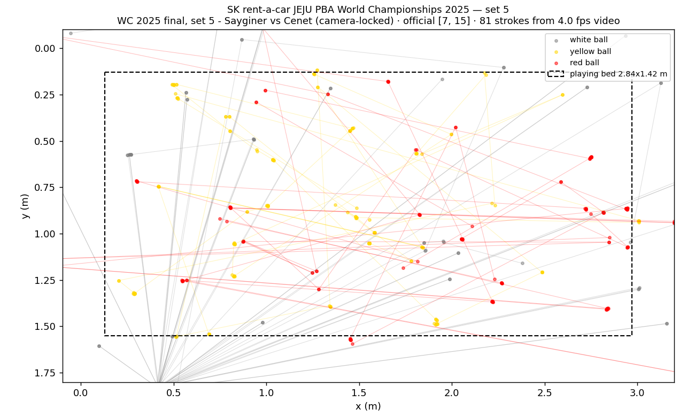

# pba-vision

Reconstruct **shot-by-shot ball positions for 3-cushion billiards** from PBA
(Korean Professional Billiards Association) broadcast recordings — and check
the reconstruction against the association's official scoring terminal.

The association publishes no ball-position data anywhere: its live terminal
records points per inning only, and the tracking graphics seen on broadcasts
are produced by the TV production and never leave the truck. This project
gets the data from the only source that has it — the video itself.

```
broadcast VOD ──▶ frame sampling ──▶ ball detection ──▶ cloth-quad homography
                                                        │ (positions in meters)
                                                        ▼
official inning sheet ◀── scoring terminal ── stroke & inning segmentation
        │
        └──▶ validation report + JSON artifact
```

## What it does, concretely

One command takes a broadcast set from YouTube to a validated artifact:

```bash
pba-vision run --video kxfju6anScQ --season 2024 --keyword 월드 \
               --players 사이그너 체네트 --workdir data --fps 4
```

- **VOD discovery** — reads the association's own media feed and scoring
  terminal (tournament → bracket → match → per-set codes). No channel
  scraping.
- **Detection** — the three balls are three distinct colours on a uniform
  cloth under studio lighting, so plain HSV segmentation with contour filters
  finds them without a learned model.
- **Geometry** — the cloth quad is detected per frame and mapped to the
  table's outer rectangle (≈3.10 × 1.70 m) with a homography. On PBA's
  overhead camera the mapping is near-affine, and rest positions repeat to
  ~5 mm median.
- **Strokes & innings** — stable multi-frame rest states become table states;
  transitions become strokes. Which balls moved classifies the outcome
  without needing cue-ball identity: the cue ball is the one struck, so
  one/two movers = miss, three movers = carom.
- **Validation** — the reconstruction is compared with the official inning
  sheet (innings, per-inning points, final totals) fetched from the scoring
  terminal. The report is printed, not massaged.

## Results — first full validated set

World Championship 2025 final (Saygıner vs Cenet), set 5, official broadcast
VOD, 21 minutes at 4 fps, CPU only:

<!-- RESULTS-BEGIN (see examples/ and docs/images for the artifact and plots) -->

| stage | result |
| --- | --- |
| frames read | 5 022 (21 min @ 4 fps, CPU only, no GPU) |
| camera survey | 28 views found, **1 stable (tripod) camera** owning 2 249 of 2 378 table frames |
| frames measured / all three balls | 1 830 on the locked camera |
| rest states → strokes | 132 → **81** |
| caroms | **15 detected vs 20 official** |
| official result | 6 innings, Cenet 7 — Saygıner 15 |
| rest-position repeatability | ~5 mm median across consecutive frames |

## The camera lock (v0.2)

A broadcast cuts constantly, and a cut is poison for position streams: the
same resting balls map a few centimetres apart on two different cameras, so
chaining rests across cuts *manufactures* movement — the v0.1 run overcounted
caroms (23 vs 20 official) exactly this way. The fix exploits a physical fact:
the scoring view is a **fixed tripod**, so its cloth quad is constant all
session. The survey pass clusters every plausible quad; the dominant cluster
is the tripod (here: 28 views found, one owning 95% of table time). Measurement
then accepts only frames on a stable camera, and strokes never span views.

The trade-off is measured, not hidden: shots that happen while only a *roaming*
camera is live have no stable quad, so they are skipped — hence 15 detected
caroms against 20 official. In exchange every position comes from one
calibrated view, and the phantom-carom bias disappears. Accepting roaming
cameras with per-frame homography is on the roadmap.

## Known, quantified gaps

Deliberate, not bugs — the validation output reports them per run:

- a carom that hits both object balls but completes fewer than three cushions
  scores nothing on the table, yet three moving balls imply one point;
- the terminal's 2-point shots are one carom each but two points on the sheet;
- shots covered only by roaming cameras are skipped (see the camera lock);
- per-stroke cue-ball identity is inferred and chaining is unreliable at 4 fps:
  estimated innings (42) vs official (6) is reported honestly in the artifact.
  Fixing it needs 60 fps burst sampling or score-bug OCR — the top roadmap item.



Known, quantified gaps (deliberate, not bugs): a carom that hits both object
balls but completes fewer than three cushions scores nothing on the table but
reads as a point from rest positions alone; the terminal's 2-point shots are
one carom each but two points on the sheet. The validation output shows the
combined gap for every run.

## Install

Python 3.10+, [ffmpeg](https://ffmpeg.org) on PATH:

```bash
pip install -e .[dev]
pytest -q        # offline; synthetic frames, no fixtures from broadcasts
```

## Commands

```bash
pba-vision videos                      # what the official feed currently offers
pba-vision find --season 2024 --keyword 월드 --players 사이그너 체네트
pba-vision run   --video kxfju6anScQ --season 2024 --keyword 월드 \
                 --players 사이그너 체네트 --workdir data --fps 4 \
                 --out reconstruction.json
python scripts/plot_reconstruction.py reconstruction.json --out scatter.png
```

The JSON artifact (`schema: pba-vision/reconstruction@0.1`) carries per-stroke
from/to positions in meters, moved-ball flags, estimated outcome and inning,
plus the official-vs-estimated validation block. A curated example ships in
[`examples/`](examples/).

## Layout

```
src/pbavision/
  ingest.py      media feed, yt-dlp download, ffmpeg frame extraction
  vision/
    detect.py    HSV ball detection + full-table gate
    camera.py    stable-camera discovery and the per-camera lock
    table.py     cloth quad, homography to table meters
  align/
    terminal.py  scoring-terminal client (TLS intermediate pinned, referer set)
    innings.py   official inning sheet parser
  pipeline.py    rest states → strokes → innings
  validate.py    reconstruction vs official sheet
  publish.py     the JSON artifact
```

## Honest limitations

- **Scoring is approximate.** Rest positions cannot see cushion counts, so
  three-cushion-rule failures overcount and 2-point shots undercount. The
  validation report quantifies this per run.
- **Cue-ball identity is inferred**, anchored by single-mover strokes and
  chained by the score/miss rule; until the first anchor it is unknown.
- **Overlays bite.** Score bugs and broadcast graphics occasionally produce
  false candidates; the table gate and per-colour best-candidate selection
  absorb most of it, not all.
- The classifier is 85% of the way with zero ML. The remaining 20% (a tiny
  YOLO detector, bed-edge refinement, 60 fps burst sampling for cushion
  counting) is the roadmap.

## Legal

Unofficial, unaffiliated with the KPA or PBA TV. Video is downloaded with
yt-dlp for personal analysis; no footage or frames are committed to this
repository. The bundled TLS certificate is a public GlobalSign intermediate.

## License

[MIT](LICENSE)
