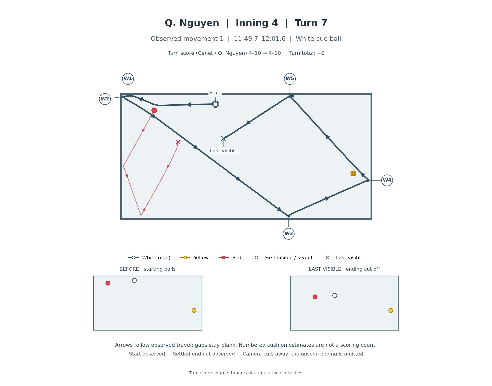
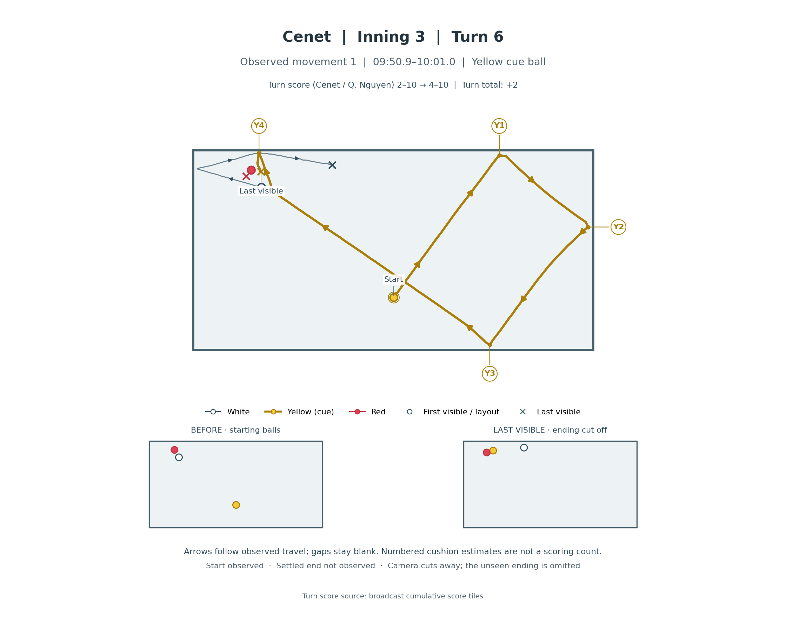

# Cenet 5 – Q. Nguyen 15

[Source: PBA TV, Team League 2026–27 Round 4, set 3](https://www.youtube.com/watch?v=jBbjq-VjxM4).

All 11 turns were scanned at the source rate of 30 fps. These 24 movement images use the same tracker and renderer. Starting balls, direction arrows, numbered cushion estimates and last-visible positions use the same conventions throughout.

Three movements have an observed settled ending. The other 21 end at a broadcast camera cut. A last-visible layout is not a final resting layout, and gaps remain blank. Points in each image are verified totals for that turn; individual movement scores are unassigned.

[Observed paths and calibration](../examples/history_team_league_2026_s3_observed.json) · [Source and review notes](../examples/history_team_league_2026_s3_review.json)

## White cue ball example

## Yellow cue ball example

## Every turn

Click a movement number to open its full image. Score order is Cenet / Q. Nguyen.

| Inning | Turn | Player | Turn points | Score after | Movement images in order |
| --- | --- | --- | --- | --- | --- |
| 1 | 1 | Q. Nguyen | +0 | 0–0 | [1](images/team-league-s3/turn_01_movement_01.png) |
| 1 | 2 | Cenet | +0 | 0–0 | [1](images/team-league-s3/turn_02_movement_01.png) |
| 2 | 3 | Q. Nguyen | +0 | 0–0 | [1](images/team-league-s3/turn_03_movement_01.png) |
| 2 | 4 | Cenet | +2 | 2–0 | [1](images/team-league-s3/turn_04_movement_01.png) · [2](images/team-league-s3/turn_04_movement_02.png) |
| 3 | 5 | Q. Nguyen | +10 | 2–10 | [1](images/team-league-s3/turn_05_movement_01.png) · [2](images/team-league-s3/turn_05_movement_02.png) · [3](images/team-league-s3/turn_05_movement_03.png) · [4](images/team-league-s3/turn_05_movement_04.png) · [5](images/team-league-s3/turn_05_movement_05.png) · [6](images/team-league-s3/turn_05_movement_06.png) · [7](images/team-league-s3/turn_05_movement_07.png) · [8](images/team-league-s3/turn_05_movement_08.png) |
| 3 | 6 | Cenet | +2 | 4–10 | [1](images/team-league-s3/turn_06_movement_01.png) · [2](images/team-league-s3/turn_06_movement_02.png) |
| 4 | 7 | Q. Nguyen | +0 | 4–10 | [1](images/team-league-s3/turn_07_movement_01.png) |
| 4 | 8 | Cenet | +0 | 4–10 | [1](images/team-league-s3/turn_08_movement_01.png) |
| 5 | 9 | Q. Nguyen | +0 | 4–10 | [1](images/team-league-s3/turn_09_movement_01.png) |
| 5 | 10 | Cenet | +1 | 5–10 | [1](images/team-league-s3/turn_10_movement_01.png) · [2](images/team-league-s3/turn_10_movement_02.png) |
| 6 | 11 | Q. Nguyen | +5 | 5–15 | [1](images/team-league-s3/turn_11_movement_01.png) · [2](images/team-league-s3/turn_11_movement_02.png) · [3](images/team-league-s3/turn_11_movement_03.png) · [4](images/team-league-s3/turn_11_movement_04.png) |
